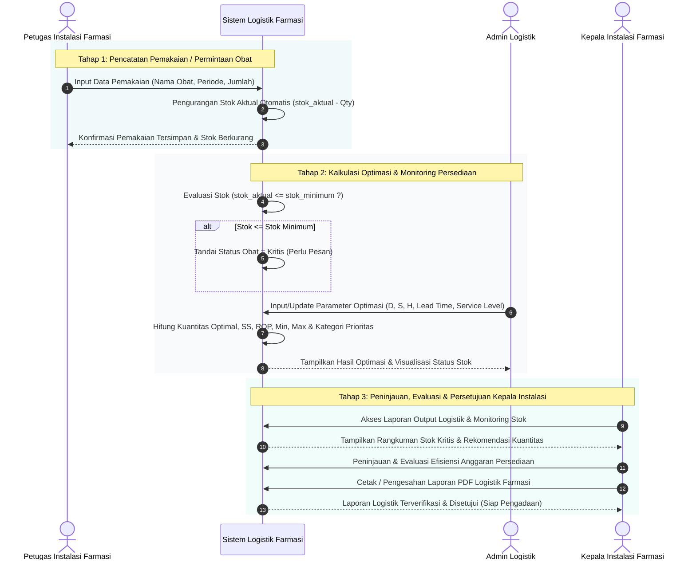

# Logistik Farmasi RS Puspa Husada Bekasi

Sistem Informasi Manajemen Logistik Farmasi RS Puspa Husada Bekasi untuk pengamanan dan optimasi persediaan obat menggunakan metode **Economic Order Quantity (EOQ)** dan **Min-Max Stock**.

---

## 🔄 Alur Operasional Logistik Farmasi (Instalasi Farmasi hingga Kepala Instalasi)

Alur proses bisnis berjalan dari pencatatan pemakaian/permintaan di tingkat Instalasi Farmasi, kalkulasi stok teroptimasi oleh sistem, hingga evaluasi dan persetujuan resmi oleh Kepala Instalasi Farmasi.

### Rincian Tahapan Alur:

1. **Tahap 1: Input Data Pemakaian oleh Instalasi Farmasi (`instalasi_farmasi`)**
    - Petugas Instalasi Farmasi menginputkan transaksi pemakaian obat harian/bulanan pada menu **Data Pemakaian**.
    - Setiap transaksi yang berhasil disimpan akan **secara otomatis mengurangi `stok_aktual` obat** pada database.
    - Apabila terdapat koreksi/perubahan data pemakaian, stok akan dikembalikan/dibereskan secara otomatis oleh sistem.

2. **Tahap 2: Pemantauan Stok & Parameter Optimasi oleh Admin (`admin`)**
    - Admin memantau kondisi persediaan riil pada menu **Monitoring Batas Stok**. Jika `stok_aktual` turun di bawah `stok_minimum`, obat otomatis berstatus **Stok Kritis**.
    - Admin mengelola master data obat (termasuk input **Tanggal Kadaluarsa / Expired Date**).
    - Admin memasukkan parameter operasional (Permintaan $D$, Biaya Pesan $S$, Biaya Simpan $H$, $Lead Time$, $Service Level$) pada menu **Parameter Optimasi Stok**.
    - Sistem secara otomatis menghitung kuantitas optimal pemesanan, titik pemesanan ulang (ROP), stok pengaman (Safety Stock), serta mengklasifikasikan prioritas persediaan.

3. **Tahap 3: Peninjauan & Persetujuan oleh Kepala Instalasi Farmasi (`kepala_instalasi`)**
    - Kepala Instalasi Farmasi masuk ke sistem untuk meninjau status ketersediaan obat dan daftar item berstatus **Stok Kritis**.
    - Kepala Instalasi memeriksa halaman **Evaluasi Efisiensi Stok** dan **Prioritas Kategori Stok** untuk memastikan efisiensi anggaran logistik.
    - Kepala Instalasi membuka menu **Laporan Sistem** dan mengunduh / mencetak **Laporan PDF Output Logistik Farmasi**.
    - Kepala Instalasi memberikan **Persetujuan Resmi (Approval)** berupa penandatanganan dokumen Laporan Logistik Farmasi sebagai dasar rujukan pengadaan obat rumah sakit.

---

## 📊 Breakdown Perhitungan dan Lokasi File

Semua logika perhitungan utama diletakkan pada layer Service, terpisah dari Controller, agar kode lebih rapi dan dapat digunakan ulang (reusable).

### 1. Perhitungan Kuantitas Pemesanan Optimal (EOQ)

**Lokasi File:** `app/Services/EoqCalculationService.php` (pada method `calculate()`)

Perhitungan dilakukan untuk mencari kuantitas pemesanan yang paling optimal dengan biaya persediaan yang paling minimal.

**Variabel yang digunakan:**

- **$D$** = Permintaan per tahun (diambil dari `rata_rata_permintaan` di `EoqParameter`)
- **$S$** = Biaya pemesanan / Ordering cost per pesanan (diambil dari `biaya_pesan`)
- **$H$** = Biaya penyimpanan / Holding cost per unit per tahun (diambil dari `biaya_simpan`). _Catatan: Jika nilai H kosong, maka H dihitung dari $I \times P$ (Faktor biaya simpan $\times$ Harga per unit)._
- **$P$** = Harga beli per unit barang (`harga_per_unit` dari `Medicine`)

**Rumus yang Diimplementasikan:**

1. **Kuantitas Pemesanan Optimal**
   $$EOQ^* = \sqrt{\frac{2 \times D \times S}{H}}$$
   _(Baris kode: `$eoqValue = sqrt((2 * $D * $S) / $H);`)_

2. **Frekuensi Pemesanan (F)**
   $$F = \frac{D}{EOQ^*}$$
   _(Berapa kali pemesanan harus dilakukan dalam satu tahun)_

3. **Total Cost / Biaya Total Persediaan (TC)**
   $$TC = \left(\frac{D}{EOQ^*} \times S\right) + \left(\frac{EOQ^*}{2} \times H\right) + (D \times P)$$
   _(Total dari Biaya Pemesanan + Biaya Penyimpanan + Biaya Pembelian Barang)_

---

### 2. Perhitungan Batas Persediaan (Min-Max Stock)

**Lokasi File:** `app/Services/EoqCalculationService.php` (pada method `calculate()`)

Digunakan untuk menentukan batas stok aman, titik pemesanan kembali (Reorder Point), serta batas bawah dan atas stok.

**Variabel tambahan yang digunakan:**

- Hari Kerja = 300 hari per tahun (konstanta `WORKING_DAYS_PER_YEAR`)
- **$d$** = Permintaan rata-rata harian ($d = \frac{D}{300}$)
- **$LT$** = Waktu tunggu / Lead Time dalam hari (diambil dari `lead_time`)
- **$Z$** = Service Level / Tingkat pelayanan (contoh: 1.65 untuk tingkat pelayanan 95%)

**Rumus yang Diimplementasikan:**

1. **Safety Stock (SS) / Stok Pengaman**
   $$SS = Z \times d \times \sqrt{LT}$$
   _(Buffer untuk mengantisipasi lonjakan permintaan atau keterlambatan pengiriman selama waktu tunggu)_

2. **Reorder Point (ROP) / Titik Pemesanan Ulang**
   $$ROP = (d \times LT) + SS$$
   _(Titik di mana sistem akan memberikan notifikasi bahwa stok sudah harus dipesan kembali)_

3. **Stok Minimum (Min)**
   $$Min = SS + (d \times LT)$$
   _(Batas paling bawah jumlah stok. Sistem akan menandai status "Kritis" jika stok aktual $\le$ Min)_

4. **Stok Maksimum (Max)**
   $$Max = Min + EOQ^*$$
   _(Batas paling atas jumlah stok. Sistem akan menandai status "Overstock" jika stok aktual $\ge$ Max)_

---

### 3. Klasifikasi Prioritas Stok (Analisis ABC)

**Lokasi File:** `app/Services/AbcAnalysisService.php` (pada method `analyze()`)

Metode klasifikasi persediaan berdasarkan nilai penyerapan modal atau nilai pemakaian (volume pemakaian $\times$ harga satuan).

**Langkah Perhitungan yang Diimplementasikan:**

1. **Hitung Nilai Pakai per Obat:**
   $$\text{Nilai Pakai} = \text{Total Permintaan Tahunan} \times \text{Harga per Unit}$$
2. **Urutkan (Sorting):** Obat diurutkan secara menurun (descending) berdasarkan Nilai Pakai tertinggi hingga terendah.
3. **Hitung Persentase Kumulatif:**
   $$\text{Persentase} = \left(\frac{\text{Nilai Pakai Obat}}{\text{Total Seluruh Nilai Pakai}}\right) \times 100\%$$
   Kemudian hitung kumulatif atau jumlah beruntun dari persentase tersebut.
4. **Klasifikasi ke dalam Kategori A, B, atau C:**
    - **Kategori A**: Persentase kumulatif 0% s/d 70% (Item sangat penting, butuh kontrol ketat).
    - **Kategori B**: Persentase kumulatif >70% s/d 90% (Item moderat/sedang).
    - **Kategori C**: Persentase kumulatif >90% s/d 100% (Item pendukung).

---

## 📂 Struktur Folder Penting

- **Models**: `app/Models/`
    - `Medicine.php`: Data Master Obat & Tanggal Kadaluarsa
    - `DemandData.php`: Data Historis Pemakaian / Permintaan Obat
    - `EoqParameter.php`: Parameter ($D, S, H, LT, Z$)
    - `EoqCalculation.php`: Menyimpan hasil perhitungan (Kuantitas Optimal, SS, ROP, Min, Max, Status)
    - `User.php`: Pengguna Aplikasi (`admin`, `instalasi_farmasi`, `kepala_instalasi`)
- **Controllers**: `app/Http/Controllers/`
    - Controller mengatur aliran data dari route ke view serta memanggil Service kalkulasi.
- **Views**: `resources/views/`
    - Menggunakan antarmuka responsif modern berbasis **Tailwind CSS**.

---

## 🗄️ Detail Database Schema & Relasi (Untuk Class Diagram & ERD)

Struktur tabel, atribut, dan relasi pada sistem Logistik Farmasi RS Puspa Husada:

### 1. Tabel `users`

Menyimpan data pengguna aplikasi dengan 3 role terpisah.

- **Atribut:**
    - `id` (PK, BigInt)
    - `name` (String)
    - `username` (String, Unique)
    - `password` (String)
    - `role` (Enum: `'admin'`, `'instalasi_farmasi'`, `'kepala_instalasi'`)
    - `created_at`, `updated_at` (Timestamp)

### 2. Tabel `medicines`

Menyimpan data master/katalog obat.

- **Atribut:**
    - `id` (PK, BigInt)
    - `kode_obat` (String, Unique)
    - `nama_obat` (String)
    - `kategori_obat` (String)
    - `satuan` (String) - _Contoh: Tablet, Botol, Strip, Box_
    - `tingkat_pemakaian` (Enum: `'Sangat Sering'`, `'Sering'`, `'Jarang'`)
    - `harga_per_unit` (Decimal)
    - `stok_aktual` (Integer)
    - `tanggal_kadaluarsa` (Date, Nullable) - _Tanggal kadaluarsa obat (Expired Date)_
    - `created_at`, `updated_at` (Timestamp)
- **Relasi:**
    - `hasMany` ke `demand_data` (Satu obat memiliki banyak riwayat pemakaian/permintaan).
    - `hasMany` ke `eoq_parameters` (Satu obat memiliki riwayat input parameter persediaan).
    - `hasMany` ke `eoq_calculations` (Satu obat memiliki riwayat perhitungan persediaan).

### 3. Tabel `demand_data`

Menyimpan data riwayat pemakaian/permintaan obat bulanan dari Instalasi Farmasi.

- **Atribut:**
    - `id` (PK, BigInt)
    - `medicine_id` (FK, BigInt) - _Merujuk ke `medicines.id`_
    - `periode` (String) - _Contoh: 'Januari 2025'_
    - `jumlah_permintaan` (Integer)
    - `created_at`, `updated_at` (Timestamp)
- **Relasi:**
    - `belongsTo` ke `medicines`.

### 4. Tabel `eoq_parameters`

Menyimpan variabel/parameter masukan yang dibutuhkan untuk menghitung Kuantitas Pemesanan Optimal dan Batas Persediaan.

- **Atribut:**
    - `id` (PK, BigInt)
    - `medicine_id` (FK, BigInt) - _Merujuk ke `medicines.id`_
    - `rata_rata_permintaan` (Decimal) - _Nilai D (Demand)_
    - `biaya_pesan` (Decimal) - _Nilai S (Ordering Cost)_
    - `biaya_simpan` (Decimal) - _Nilai H (Holding Cost)_
    - `faktor_biaya_simpan` (Decimal) - _Nilai % jika H dihitung dari Harga \* Faktor_
    - `lead_time` (Integer) - _Nilai LT (Waktu tunggu dalam hari)_
    - `service_level_z` (Decimal) - _Nilai Z (Contoh 1.65 untuk 95%)_
    - `created_at`, `updated_at` (Timestamp)
- **Relasi:**
    - `belongsTo` ke `medicines`.
    - `hasMany` ke `eoq_calculations`.

### 5. Tabel `eoq_calculations`

Menyimpan hasil perhitungan sistem dari kuantitas optimal dan batas persediaan.

- **Atribut:**
    - `id` (PK, BigInt)
    - `medicine_id` (FK, BigInt) - _Merujuk ke `medicines.id`_
    - `eoq_parameter_id` (FK, BigInt) - _Merujuk ke `eoq_parameters.id`_
    - `eoq_value` (Decimal) - _Hasil optimal pemesanan_
    - `frekuensi_pesan` (Decimal) - _Frekuensi pesan dalam setahun (F)_
    - `total_cost` (Decimal) - _Total Biaya Persediaan (TC)_
    - `safety_stock` (Decimal) - _Stok Pengaman (SS)_
    - `reorder_point` (Decimal) - _Titik pemesanan kembali (ROP)_
    - `stok_minimum` (Decimal) - _Batas bawah stok_
    - `stok_maksimum` (Decimal) - _Batas atas stok_
    - `status` (String) - _Indikator status persediaan (Aman / Kritis / Overstock)_
    - `created_at`, `updated_at` (Timestamp)
- **Relasi:**
    - `belongsTo` ke `medicines`.
    - `belongsTo` ke `eoq_parameters`.
